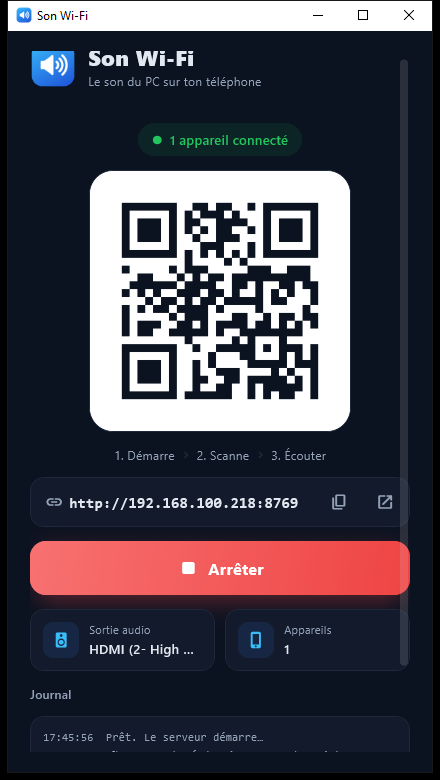

<p align="center"></p>

<h1 align="center">Son Wi-Fi</h1>
<p align="center"><b>Le son de ton PC Windows, sur ton téléphone, par le Wi-Fi.</b><br>
Rien à installer sur le téléphone : tu scannes le QR code, tu appuies sur Écouter.</p>

<p align="center">
  <a href="https://__PAGES__">🌐 Site</a> ·
  <a href="https://github.com/__DEPOT__/releases/latest/download/SonWifi.exe">⬇️ Télécharger SonWifi.exe</a>
</p>

<p align="center"></p>

## Fonctions

- **QR code instantané** : l'appli démarre le serveur et affiche le QR code à scanner.
- **Qualité adaptative** : 6 niveaux, de 96 à 1536 kb/s. Elle s'ajuste au Wi-Fi comme une vidéo en streaming.
- **Coupures masquées** : un son de remplacement et des fondus enchaînés évitent les clics et les silences.
- **3 modes** sur le téléphone : 🐢 Faible, ⚖️ Stable (trouve la meilleure qualité qui ne coupe pas, puis se verrouille dessus), 💎 HD.
- **Écran toujours allumé** : un bouton empêche le téléphone de se mettre en veille.
- **100 % local** : aucun compte, aucun cloud.

## Utilisation

1. Lance `SonWifi.exe` (PC et téléphone sur le même Wi-Fi).
2. Scanne le QR code avec l'appareil photo du téléphone.
3. Appuie sur **Écouter**.

> Au premier lancement, autorise Son Wi-Fi sur les **réseaux privés** dans le pare-feu Windows.
> L'exe n'est pas signé : si Windows SmartScreen s'affiche, clique sur « Informations complémentaires » puis « Exécuter quand même ».

## Depuis le code source

```bash
pip install -r requirements.txt
python app.py        # application avec interface
python son_wifi.py   # version terminal (QR code dans la console)
```

### Compiler l'exe

```bash
pip install flet-cli flet-desktop pyinstaller
flet pack app.py -i assets/icon.ico -n SonWifi --add-data "assets:assets" -y
```

L'exe se trouve dans `dist/SonWifi.exe`.

## Structure

| Fichier | Rôle |
|---|---|
| `son_wifi.py` | Serveur audio (capture WASAPI, encodage adaptatif, page web du téléphone) |
| `app.py` | Application Windows (Flet) |
| `outils/creer_icone.py` | Génère l'icône |
| `docs/` | Site vitrine (GitHub Pages) |

## Licence

[MIT](LICENSE)
